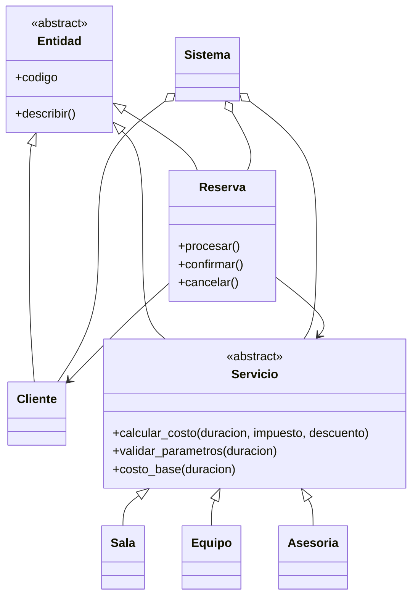

# Guía técnica y sustentación

## 1. Problema y objetivo

Software FJ necesita gestionar clientes, salas, equipos, asesorías y reservas sin una base de datos. El objetivo es mantener la aplicación operativa ante datos incorrectos y restricciones de negocio. Los comentarios de cada línea ejecutable explican el propósito, los parámetros y las decisiones. Esta guía complementa los comentarios con la relación entre las clases.

## 2. Diagrama de clases (Mermaid compatible con GitHub)



## 3. Diccionario de variables y condiciones

| Variable o atributo | Tipo | Propósito y validación |
|---|---|---|
| self | instancia | Accede al estado del objeto actual. |
| codigo / __codigo | str | Identidad no vacía; única dentro de cada lista. |
| nombre / __nombre | str | Nombre no vacío, sin espacios exteriores. |
| correo / __correo | str | Formato básico de correo, normalizado a minúsculas; sin duplicados. |
| telefono / __telefono | str | Entre 7 y 15 dígitos. |
| valor, campo | variable, str | Entrada original y etiqueta usada en errores. |
| n, minimo | Decimal, número | Valor convertido y límite inferior. Se rechazan NaN e infinito. |
| tarifa / __tarifa | Decimal | Precio horario, mínimo 0.01 COP. |
| disponible / __disponible, estado | bool | Disponibilidad administrativa; no se aceptan cadenas o números. |
| duracion / __duracion, horas | Decimal | Horas, mínimo 1 y máximo según el servicio. |
| limite | int | Sala 12, equipo 48, asesoría 8 horas. |
| impuesto, iva | Decimal tras conversión | Porcentaje de impuesto, 0 a 100. |
| descuento, rebaja | Decimal tras conversión | Porcentaje de descuento, 0 a 100. |
| base, total, importe | Decimal | Precio base, resultado final redondeado y valor de confirmación. |
| factor | Decimal | 0.90 para asesorías de 4 horas o más; 1 en otro caso. |
| __cliente, __servicio | Cliente, Servicio | Referencias a objetos vinculados con la reserva. |
| __estado | str | PENDIENTE, CONFIRMADA o CANCELADA. |
| __total | Decimal o None | Importe fijado al confirmar, inicialmente ausente. |
| __clientes, __servicios, __reservas | list | Colecciones privadas en memoria. |
| lista, objeto, item, c, s, r, reserva | list u objeto | Colección o referencia temporal usada en búsquedas y validaciones. |
| logger, log, archivo, formato | objetos logging | Administran destino, nivel, formato y registro. |
| error | Exception | Excepción capturada; permite registrar la traza y explicar el fallo. |
| nombre, accion, resultado, detalle | str, callable, objeto, str | Etiqueta, función diferida, valor retornado y presentación del resultado. |
| casos, esperado, ok, aciertos, exitos | list, bool, bool, int, int | Casos, expectativa, resultado real y contadores de simulación. |
| captura | contexto de unittest | Permite inspeccionar la excepción esperada. |

## 4. Explicación de principios POO

- Abstracción: Entidad obliga a implementar describir; Servicio obliga a validar parámetros y calcular costo base. No se pueden instanciar directamente.
- Herencia: Cliente, Reserva y Servicio reutilizan el código de Entidad; Sala, Equipo y Asesoria reutilizan tarifa y disponibilidad de Servicio.
- Encapsulación: atributos con doble guion bajo y propiedades de lectura. Las listas son privadas. Python aplica name mangling, no seguridad absoluta.
- Polimorfismo: una lista admite los tres tipos de servicio. La misma llamada calcular_costo invoca costo_base y validar_parametros de la instancia concreta. El método describir también se sobrescribe.
- Sobrecarga simulada: Python no permite varias definiciones del mismo método diferenciadas por cantidad de parámetros como Java. Se usan parámetros opcionales: calcular_costo(2), calcular_costo(2, 19), calcular_costo(2, 19, 10), calcular_costo(2, descuento=10).

## 5. Manejo de errores

`numero` usa try/except y `raise ... from error` para traducir un error técnico de conversión al error de negocio DatosInvalidos sin perder su causa. `calcular_costo` transforma errores aritméticos en CalculoInvalido. `Sistema.ejecutar` usa try/except/else/finally: intenta la acción, captura primero errores propios y luego fallos inesperados, registra los éxitos únicamente en else y registra el final en finally. Un error no pasa al siguiente caso: cada operación se aísla. Las pruebas directas de los modelos capturan excepciones con unittest y no pasan por el registrador; las operaciones de la aplicación sí pasan por ejecutar. Si el archivo no puede abrirse, hay un aviso y registro de respaldo en consola. No se promete recuperación ante fallos del sistema operativo, pérdida de energía o interrupción manual.

## 6. Cálculo y reglas

Sala: 50.000 × 2 = 100.000 COP; con descuento 10% e impuesto 19%: 100.000 × 0.90 × 1.19 = 107.100 COP.
Equipo: 30.000 × 3 + 15.000 = 105.000 COP.
Asesoría: 80.000 × 4 × 0.90 × 1.19 = 342.720 COP.

El estado inicial es PENDIENTE. Confirmar requiere que el servicio esté disponible, no exista otra confirmación activa y el cálculo sea válido. La confirmación solo modifica el estado después del cálculo. Cancelar permite liberar una reserva y rechaza una segunda cancelación. No hay fechas ni calendario porque el anexo no los exige; se propone exclusividad por servicio durante toda la confirmación activa.

## 7. Matriz de cumplimiento

| Requisito del anexo | Evidencia |
|---|---|
| Entidad abstracta | modelos.py: Entidad |
| Cliente validado | Cliente, texto, numero, registrar_cliente |
| Servicio abstracto y tres especializaciones | Servicio, Sala, Equipo, Asesoria |
| Reserva y transiciones | Reserva, confirmar_reserva, cancelar_reserva |
| Sobrecarga mediante opcionales | Servicio.calcular_costo |
| Excepciones personalizadas y encadenadas | excepciones.py, numero, calcular_costo |
| try/except/else/finally | Sistema.ejecutar |
| Listas, sin base de datos | Sistema.__init__ |
| Registro de eventos y errores | configurar_log, eventos.log |
| Mínimo 10 operaciones | main.py: 28 operaciones |
| Código comentado | comentarios en los archivos Python |

## 8. GitHub (repositorio asignado por el docente)

Cada integrante debe ingresar con su propia cuenta. Antes de copiar el proyecto, revisar si ya existe código para no sobrescribir aportes. Desde una terminal con Git instalado:

```bash
git clone URL_REAL_DEL_REPOSITORIO
cd NOMBRE_DEL_REPOSITORIO
# Copiar los archivos del proyecto a la carpeta clonada y revisar los cambios.
git status
git add README.md GUIA_TECNICA.md excepciones.py modelos.py sistema.py main.py test_sistema.py eventos.log .gitignore
git commit -m "Implementa y valida sistema Software FJ"
git push
```

Si el repositorio usa ramas y pull requests, seguir las instrucciones del docente. Propuesta de reparto (no evidencia de aportes realizados): integrante 1 validaciones y Cliente; 2 Servicio y especializaciones; 3 Reserva y reglas de estado; 4 gestión y logging; 5 simulación, pruebas y documentación. Cada persona debe realizar sus propios cambios, pruebas y commits reales. Copiar el enlace auténtico al informe y compartirlo en el foro de la actividad.

## 9. Explicación oral sugerida

El sistema está organizado por responsabilidades. Los modelos validan las reglas propias de cada objeto, el gestor coordina las listas y el simulador ejecuta operaciones en secuencia. Se presenta primero un cliente válido, después uno inválido y luego otro registro válido para demostrar continuidad. Se muestran los tres servicios, la confirmación de reserva, el bloqueo por ocupación, la cancelación y el reintento. Finalmente, se abre eventos.log para observar los errores y sus causas. No usamos una base de datos y no conservamos datos personales entre sesiones.

## 10. Referencias indicadas en la guía de la actividad

Van Rossum, G., & Drake, F. L., Jr. (2024). *El tutorial de Python: errores y excepciones*. Python Software Foundation. https://docs.python.org/es/3.12/tutorial/errors.html

Universidad Nacional Abierta y a Distancia. (2026). *Guía de aprendizaje para el desarrollo del componente práctico del curso Programación 213023*. 

Universidad Nacional Abierta y a Distancia. (s. f.). *Anexo 3: Problema a desarrollar Fase 4*.

Zambrano, J. P. (2025). *Introducción al uso de GitHub* [Objeto virtual de información]. Repositorio Institucional UNAD. https://repository.unad.edu.co/handle/10596/75876
